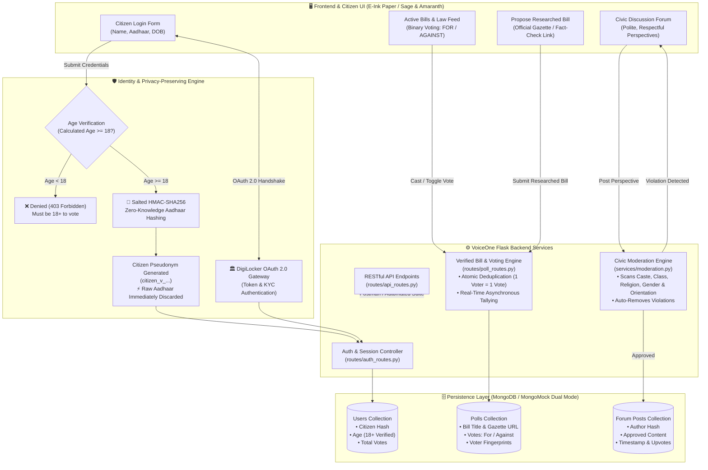

# VoiceOne 🗳️ — Secure & Privacy-Preserving Civic Polling

**VoiceOne** is a sovereign civic polling and discussion platform enabling citizens to express verified opinions on legislative bills, national laws, and societal policies. Authenticated via **DigiLocker OAuth 2.0**, citizens are verified to be 18+ years of age, while their **Aadhaar numbers are never stored in plaintext**—they are cryptographically salted and hashed into unique anonymous voter identifiers (`citizen_v_...`).

---

## 🎨 Visual Identity & Design System
- **Backdrop**: Sage Green (`#87AE73`)
- **Icons, Headings & Primary Accents**: Amaranth Pink (`#9F2B68`)
- **Panels & Ballots**: Tactile **E-Ink / Cream Paper Panels** (`#FAF7F2`) with crisp editorial borders and ink shadows (`box-shadow: 4px 4px 0px rgba(159, 43, 104, 0.35)`).
- **Typography**: Google Fonts (*Outfit* and *Plus Jakarta Sans*).

---

## 🏛️ System Architecture & Workflow Diagram



---

## 🛡️ Core Security & Architectural Features

1. **DigiLocker OAuth 2.0 & Salted Aadhaar Anonymization**:
   - Accepts Name, 12-digit Aadhaar, and Date of Birth (DOB).
   - Strict Age Eligibility: Under-18 users are rejected.
   - **Zero Plaintext Storage**: Plaintext Aadhaar is never saved in the database or server logs. It is instantly transformed into a cryptographically salted one-way hash (`SHA-256` / `HMAC-SHA256`) acting as a secure voter pseudonym to enforce one-citizen-one-vote while preserving privacy.
2. **Verified Legislative Bills & Binary Voting**:
   - Poll creation requires reference to official gazette notices or fact-checked sources.
   - Strict binary voting: **FOR** (Support) or **AGAINST** (Oppose).
   - Real-time percentage calculation with zero latency.
3. **Automated Civic Moderation Engine**:
   - Real-time civility scanning enforcing polite discourse.
   - Prohibits discrimination based on **caste, class, religion, sexual orientation, or gender**, as well as profanity and harassment. Violations are **automatically removed**.
4. **Resilient Dual-Mode Database**:
   - Native support for live MongoDB (Local or MongoDB Atlas) with an automatic embedded in-memory fallback (`mongomock`) for zero-configuration testing and continuous integration.

---

## 🚀 Quick Start

### 1. Install Dependencies
```bash
pip install -r requirements.txt
```

### 2. Run the Application
```bash
python app.py
```
Open your browser at [http://127.0.0.1:5000](http://127.0.0.1:5000).

---

## 🧪 Testing

### 1. Automated Backend Unit & Integration Tests
```bash
python -m unittest tests/test_backend.py
```

### 2. Automated Selenium Browser Workflow
```bash
python -m unittest tests/test_voiceone_selenium.py
```

### 3. Postman API Validation
Import `tests/VoiceOne_Postman_Collection.json` and `tests/VoiceOne_Postman_Environment.json` into Postman to execute all API endpoints.

---

## ☁️ Deployment on Render
1. Push the repository to GitHub.
2. Create a new **Web Service** on [Render.com](https://render.com).
3. Connect your repository. Render will automatically detect `render.yaml` and `Procfile`.
4. Set environment variables (e.g. `MONGO_URI`, `SECRET_KEY`, `AADHAAR_HASH_SALT`).
